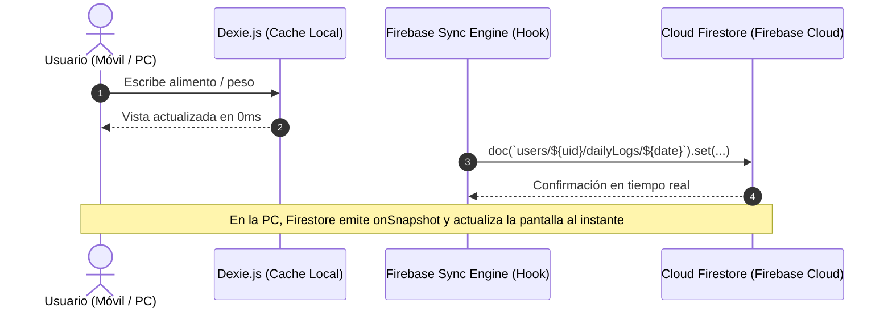

# 🦦 Nutria — Software Requirements Document (SRD)

**Versión:** 1.4.0  
**Estado:** Aprobado  
**Tipo:** PWA Personal / Health, Cycle & Nutrition Multi-Device Ecosystem  
**Arquitectura:** Next.js 16 (App Router) + FSD (Feature-Sliced Design) + **Firebase (Auth con Google + Cloud Firestore Sync)** + Local-First Cache (Dexie.js / IndexedDB) + Tailwind CSS v4 + Framer Motion  

---

## 1. Visión del Producto y Objetivos

**Nutria** es una Progressive Web App (PWA) de nutrición, ejercicio, bienestar emocional y seguimiento del ciclo menstrual con **sincronización multi-dispositivo en tiempo real (Celular $\leftrightarrow$ PC)**. Combina ciencia nutricional con salud hormonal femenina en una experiencia *Cozy Creative & Girly Tech*, guiada por una mascota nutria reactiva en lineart.

### Objetivos Clave

1. **Sincronización Multi-Dispositivo Transparente:** Inicio de sesión con Google (Firebase Auth) y sincronización automática en la nube (Cloud Firestore). Lo que registrás en el celular se refleja al instante en la PC y viceversa.
2. **Resiliencia Offline y 0ms de Latencia:** Arquitectura híbrida donde Dexie.js (IndexedDB) actúa como caché local ultra-rápida y cola offline, sincronizando con Firebase en segundo plano.
3. **Registro ultrarrápido (< 30 segundos por comida):** Botones de "repetir comida de ayer", favoritos anclados arriba, combos habituales y parser de texto en lenguaje natural.
4. **Inmutabilidad de Datos (Snapshot Pattern):** Cada comida registrada en el diario guarda una copia exacta e inmutable de los datos nutricionales en ese momento, evitando alteraciones históricas si el ingrediente base cambia en el futuro.
5. **Registro de Recetas por Bloque Unificado (Opción A):** Al agregar una porción de una receta (ej. "1 porción de Tarta de Verduras"), se registra en el diario como una entrada consolidada con sus macros calculados, manteniendo la vista limpia.
6. **Sincronización de Nutrición y Ciclo Menstrual Personalizable:** 4 fases hormonales, duración de ciclo configurable (24 a 35 días), duración de sangrado configurable (3 a 7 días), correlación de retención de líquidos con la curva de peso y avisos contextuales de ajuste calórico en la fase lútea.
7. **Cálculo Metabólico y de Macros Dual:** Fórmula de **Mifflin-St Jeor** para TMB y cálculo de macros configurable tanto por peso corporal (g/kg de proteína y grasa) como por porcentaje estándar.
8. **Arquitectura Modular Extrema ("Zero-Code Pages"):** Las páginas actúan únicamente como ensambladores mínimos de vistas. Todo componente es reutilizable y generado estrictamente con Plop.

---

## 2. Modelos de Dominio y Fórmulas Matemáticas

### 2.1. Fórmulas Metabólicas (Mifflin-St Jeor)

#### A. Tasa Metabólica Basal (TMB / BMR)

Para mujeres:
$$\text{TMB} = (10 \times \text{peso en kg}) + (6.25 \times \text{altura en cm}) - (5 \times \text{edad en años}) - 161$$

#### B. Gasto Energético Total Diario (GET / TDEE)

$$\text{GET} = \text{TMB} \times \text{Factor de Actividad (PAL)}$$

| Nivel de Actividad | Factor (PAL) | Descripción |
| :--- | :--- | :--- |
| Sedentario | 1.2 | Poco o ningún ejercicio, trabajo de escritorio |
| Ligero | 1.375 | Ejercicio ligero 1-3 días/semana |
| Moderado | 1.55 | Ejercicio moderado 3-5 días/semana |
| Intenso | 1.725 | Ejercicio fuerte 6-7 días/semana |
| Muy Intenso | 1.9 | Atleta o trabajo físico pesado |

#### C. Índice de Masa Corporal (IMC / BMI)

$$\text{IMC} = \frac{\text{peso en kg}}{(\text{altura en metros})^2}$$

#### D. Planes de Objetivo Calórico

- **Perder peso rápido:** Déficit de **300 a 500 kcal/día** (configurable por el usuario).
- **Perder peso moderado:** Déficit de **100 a 300 kcal/día** (ideal para recomposición corporal).
- **Mantener peso:** 0 kcal de déficit (Calorías = GET).

#### E. Ecuación Dinámica del Presupuesto Diario

$$\text{Calorías Restantes} = \text{Calorías Objetivo} - \text{Calorías Ingeridas} + \text{Calorías Quemadas por Ejercicio}$$

#### F. Cálculo Proporcional de Ejercicio

Dado un ejercicio base registrado como $(t_{\text{base}}, \text{kcal}_{\text{base}})$:
$$\text{kcal}_{\text{actual}} = \left(\frac{t_{\text{modificado}}}{t_{\text{base}}}\right) \times \text{kcal}_{\text{base}}$$

#### G. Metas de Macronutrientes (Modo Dual Configurable)

1. **Modo por Peso Corporal (Recomendado):**
   - Proteínas: $1.8\text{g} - 2.2\text{g}$ por kg de peso corporal ($1\text{g} = 4\text{ kcal}$).
   - Grasas: $0.8\text{g} - 1.0\text{g}$ por kg de peso corporal ($1\text{g} = 9\text{ kcal}$).
   - Carbohidratos: Remanente calórico dividido por $4\text{ kcal/g}$.
2. **Modo Porcentual:**
   - Sliders de distribución porcentual personalizada (ej. 40% C / 30% P / 30% G).

---

### 2.2. Motor del Ciclo Menstrual (4 Fases & Predicción Configurable)

A partir del último día de inicio de sangrado ($D_0$), la duración total del ciclo ($L_{\text{ciclo}}$, default: 28 días) y la duración del período ($L_{\text{período}}$, default: 5 días):

1. **Fase Menstrual:** Días $1$ a $L_{\text{período}}$ (Sangrado activo, descanso, alimentos reconfortantes ricos en hierro).
2. **Fase Folicular:** Días $L_{\text{período}} + 1$ hasta el día $\text{Ovulación} - 2$ (Estrógenos en aumento, alta energía).
3. **Fase Ovulatoria:** Días $\text{Ovulación} - 1$ a $\text{Ovulación} + 1$ (donde $\text{Ovulación} \approx L_{\text{ciclo}} - 14$).
4. **Fase Lútea:** Días $\text{Ovulación} + 2$ hasta $L_{\text{ciclo}}$ (Progesterona alta, aumento de TMB +150 a +250 kcal/día, retención hídrica).
5. **Predicción Próximo Período:** $D_0 + L_{\text{ciclo}}$ días (marcador punteado con ícono de gota en el calendario).
6. **Alerta Contextual de Fase Lútea:** Banner interactivo en el diario *"Estás en tu fase lútea: tu cuerpo quema ~150-200 kcal más. ¿Deseas aplicar un ajuste temporal a tu meta hoy?"* `[Aplicar +150 kcal]` / `[Mantener igual]`.

---

## 3. Sistema de Diseño, Tokens y Paletas de Colores

### 3.1. Tipografías

- **Display & Títulos:** `Fraunces` (Google Font serif moderna y expresiva).
- **Interfaz, Textos y Números:** `Poppins` (Google Font sans-serif geométrica y legible).

### 3.2. Iconografía Oficial (`@phosphor-icons/react`)

- **Librería:** **Phosphor Icons**.
- **Estilo Base:** `duotone` y `regular`.
- **Integración con Tokens:** Los íconos en variante `duotone` consumen los dos tonos del tema activo (relleno en `--color-primary-light` / `--color-secondary-light` y trazo en `--color-primary-dark` / `--color-secondary-dark`), brindando un acabado gráfico acogedor, suave y de autor.

### 3.3. Sistema de Tokens Semánticos (con Variantes `-light` y `-dark`)

```css
/* ==========================================================================
   TEMA 1: MATCHA & PEACH SORBET (Default)
   ========================================================================== */
:root, [data-theme="matcha-peach"] {
  --font-display: 'Fraunces', serif;
  --font-sans: 'Poppins', sans-serif;
  
  /* Fondos y Superficies */
  --color-bg: #FDFBF7;
  --color-surface: #FFFFFF;
  --color-surface-hover: #F7F3EC;
  --color-border: #EFE8DE;
  --color-text-main: #332B29;
  --color-text-muted: #7E726E;
  
  /* Primary (Peach) */
  --color-primary-light: #FFD5CC;
  --color-primary: #FFB4A2;
  --color-primary-dark: #E68D77;
  --color-primary-text: #5A2A20;
  
  /* Secondary (Matcha) */
  --color-secondary-light: #E0EBC7;
  --color-secondary: #C5D8A4;
  --color-secondary-dark: #9AB472;
  --color-secondary-text: #2D4016;
  
  /* Accent (Terracotta) */
  --color-accent-light: #F4A792;
  --color-accent: #E07A5F;
  --color-accent-dark: #B85338;
  
  /* Menstrual (Coral Red) */
  --color-menstrual-light: #FFE2E3;
  --color-menstrual: #E76F74;
  --color-menstrual-dark: #C2484E;
  
  /* Love / Intimacy (Rose) */
  --color-love-light: #FCD6E5;
  --color-love: #F49AC2;
  --color-love-dark: #CF6595;

  /* Macros */
  --color-macro-carbs: #F4A261;
  --color-macro-protein: #E76F51;
  --color-macro-fat: #2A9D8F;

  --radius-card: 1.25rem;
  --radius-button: 0.875rem;
}

/* ==========================================================================
   TEMA 2: CYBER LILAC & BERRY BLUSH
   ========================================================================== */
[data-theme="cyber-lilac"] {
  --color-bg: #FAF7FD;
  --color-surface: #FFFFFF;
  --color-surface-hover: #F2ECFA;
  --color-border: #EADBFA;
  --color-text-main: #2A2333;
  --color-text-muted: #756B82;
  
  /* Primary (Lilac) */
  --color-primary-light: #EADBFA;
  --color-primary: #D4BEE4;
  --color-primary-dark: #B08FC9;
  --color-primary-text: #3D2254;
  
  /* Secondary (Blush Pink) */
  --color-secondary-light: #FDE2ED;
  --color-secondary: #F8C8DC;
  --color-secondary-dark: #DB98B3;
  --color-secondary-text: #522036;
  
  /* Accent (Berry) */
  --color-accent-light: #EE81A3;
  --color-accent: #D84A75;
  --color-accent-dark: #A62950;
  
  /* Menstrual */
  --color-menstrual-light: #FDE8EF;
  --color-menstrual: #D84A75;
  --color-menstrual-dark: #A62950;
  
  /* Love */
  --color-love-light: #FFA6C9;
  --color-love: #FF70A6;
  --color-love-dark: #D93B78;

  /* Macros */
  --color-macro-carbs: #D4BEE4;
  --color-macro-protein: #D84A75;
  --color-macro-fat: #7EB0D5;
}

/* ==========================================================================
   TEMA 3: WARM OTTER EARTH & PASTEL CORAL
   ========================================================================== */
[data-theme="warm-otter"] {
  --color-bg: #FBF8F4;
  --color-surface: #FFFFFF;
  --color-surface-hover: #F5EFE6;
  --color-border: #E9DECE;
  --color-text-main: #2F2923;
  --color-text-muted: #786C60;
  
  /* Primary (Otter Caramel) */
  --color-primary-light: #E8C497;
  --color-primary: #D9A566;
  --color-primary-dark: #B37D3D;
  --color-primary-text: #422B0E;
  
  /* Secondary (Soft Aqua) */
  --color-secondary-light: #CEEBEB;
  --color-secondary: #A8DADC;
  --color-secondary-dark: #74B1B3;
  --color-secondary-text: #1D3557;
  
  /* Accent (Warm Coral) */
  --color-accent-light: #F2957D;
  --color-accent: #E76F51;
  --color-accent-dark: #BF472A;
  
  /* Menstrual */
  --color-menstrual-light: #FCE8E9;
  --color-menstrual: #E63946;
  --color-menstrual-dark: #B51B27;
  
  /* Love */
  --color-love-light: #F8C39B;
  --color-love: #F4A261;
  --color-love-dark: #CB722E;

  /* Macros */
  --color-macro-carbs: #F4A261;
  --color-macro-protein: #E63946;
  --color-macro-fat: #A8DADC;
}
```

---

## 4. Catálogo Exhaustivo de Componentes Reutilizables

### 4.1. Layout & Navegación (`src/components/layout/`)

1. **`AppLayout`**: Shell responsive que detecta el viewport y renderiza el `DesktopSidebar` o el `BottomNavBar`.
2. **`Header`**: Barra superior fija con saludo personalizado, fecha actual navegable, avatar de Nutria, botón de Google Login y selector de temas.
3. **`BottomNavBar`**: Barra de navegación inferior móvil para PWA con badges y animación de pestaña activa en `Framer Motion`.
4. **`DesktopSidebar`**: Barra lateral de navegación para tablets y pantallas de escritorio.
5. **`PageContainer`**: Wrapper unificado de página con paddings consistentes y scroll suave.
6. **`SyncStatusBadge`**: Indicador visual discreto de sincronización en tiempo real con Cloud Firestore (🟢 Sincronizado, 🟡 Local/Offline, 🔄 Sincronizando).

### 4.2. Elementos Atómicos y Formularios (`src/components/ui/`)

1. **`Button`**: Variantes (`primary`, `secondary`, `accent`, `outline`, `ghost`, `danger`, `menstrual`, `love`) con soporte para tamaños y microinteracción `whileTap`.
2. **`IconButton`**: Botón de acción circular/cuadrado con tooltip integrado (favorito, editar, borrar, cerrar, filtros).
3. **`Input`**: Campo de texto estilizado con soporte de label flotante, helper text y estados de error.
4. **`NumberInput`**: Input optimizado para pesos y calorías con botones de ajuste fino `+` / `-`.
5. **`SearchInput`**: Campo de búsqueda con debounce integrado, ícono de lupa y botón para limpiar texto.
6. **`Select` / `SegmentedControl`**: Selector de pestañas redondeadas tipo cápsula (*pills*) o dropdown estilizado.
7. **`ToggleSwitch`**: Switch animado para opciones booleanas (ej. favorito, nota de amor, inicio de período).
8. **`Badge`**: Pill para tags de recetas, estados nutricionales y fases hormonales (`menstrual`, `follicular`, `ovulation`, `luteal`).
9. **`Card`**: Contenedor base polimórfico (`elevated`, `flat`, `interactive`).
10. **`Modal` & `BottomSheet`**: Diálogos modales y drawers inferiores con backdrop desenfocado y animaciones de entrada/salida.
11. **`ConfirmModal`**: Modal de confirmación destructiva con ilustración de Nutria y advertencia contextual.
12. **`EmptyState`**: Vista para listas vacías con ilustración SVG de Nutria, mensaje cálido y botón de acción principal.
13. **`SkeletonLoader`**: Marcador de posición animado tipo *shimmer* para tarjetas, listas y gráficos.
14. **`ToastNotification`**: Banner emergente de avisos y confirmaciones (ej. alerta de ajuste en fase lútea).

### 4.3. Visualización de Datos, Gráficos & Progreso (`src/components/charts/` & `src/components/progress/`)

 1. **`MacroProgressBar`**: Barra de progreso segmentada multicolor (Carbos, Proteínas, Grasas) con tooltips de gramos y porcentajes.
 2. **`MacroNutrientPill`**: Mini cápsula individual indicando gramos de Carbohidratos, Proteínas o Grasas con su color de token.
 3. **`CircularProgress`**: Anillo SVG interactivo para visualizar calorías restantes del día o tiempo transcurrido en el ayuno.
 4. **`StatCard`**: Tarjeta de estadística individual con título, valor destacado, unidad, icono y comparativa.
 5. **`TrendLineChart`**: Gráfico lineal SVG interactivo para peso histórico y medidas antropométricas con sombreado de zonas del ciclo menstrual.
 6. **`CorrelationChart`**: Gráfico de correlación entre puntuación de ánimo (1-5) vs déficit calórico diario.
 7. **`StreakHeatmap`**: Mapa de calor mensual estilo contribution graph para racha de hábitos y registros.
 8. **`DateNavigator`**: Barra interactiva `[<] [Hoy / Fecha Formateada] [>]` con acceso a selector de fecha.

### 4.4. Componentes de Dominio y Entidades Reutilizables

 1. **`NutriaMascot`**: Mascota SVG en lineart estilizado con estados reactivos:
    - Ánimo 1 a 5.
    - Fase menstrual activa (abrazando chocolate y bolsita de agua caliente).
    - Meta calórica/ejercicio cumplida (nutria celebrando con pesas).
 2. **`IngredientImage`**: Thumbnail de alimento con fallback automático a icono ilustrado vectorial si no hay foto.
 3. **`IngredientRow` / `IngredientCard`**: Fila o tarjeta de ingrediente mostrando foto, nombre, porción, macros y botones de acción (editar, eliminar, alternar favorito ⭐).
 4. **`IngredientSelectorModal`**: Modal reutilizado tanto en el Diario como en el Constructor de Recetas para buscar y añadir ingredientes rápidamente.
 5. **`RecipeCard`**: Tarjeta de receta con foto, porciones, tags y desglose de macros por porción.
 6. **`ExerciseCard`**: Tarjeta de ejercicio con campo de duración interactivo que recalcula las calorías quemadas proporcionalmente.
 7. **`FastingTimerWidget`**: Widget circular de ayuno intermitente con timestamp absoluto, selección de protocolo (16:8, 14:10) e indicador de fase metabólica.
 8. **`MoodSelector`**: Selector horizontal interactivo de 1 a 5 con las expresiones ilustradas de la Nutria.
 9. **`QuickFoodInput`**: Campo de entrada rápida con parser de lenguaje natural (*"150g pechuga de pollo, 100g arroz blanco"*).
10. **`DayCell`**: Celda de día individual en el calendario con badges de ejercicio, amor, ciclo, ánimo y déficit.

---

## 5. Esquema de Datos Sincronizado (Firebase + Dexie Cache)



### 5.1. Interfaces TypeScript

```typescript
export interface UserProfile {
  userId: string; // Firebase Auth UID
  email?: string;
  weightKg: number;
  heightCm: number;
  birthDate: string; // YYYY-MM-DD
  activityLevel: 'sedentary' | 'light' | 'moderate' | 'intense' | 'very_intense';
  goalType: 'fast_loss' | 'moderate_loss' | 'maintenance';
  customDeficitKcal: number; // 100 a 500 kcal
  macroCalculationMode: 'body_weight' | 'percentage';
  proteinGramsPerKg?: number; // Default 2.0
  fatGramsPerKg?: number; // Default 0.9
  macroPercentages?: { carbs: number; protein: number; fat: number };
  selectedTheme: 'matcha-peach' | 'cyber-lilac' | 'warm-otter';
  cycleLengthDays: number; // Default: 28 (rango 24-35)
  periodDurationDays: number; // Default: 5 (rango 3-7)
}

export interface Ingredient {
  id: string;
  userId: string;
  name: string;
  brand?: string;
  portionGrams: number; // Porción estándar (ej. 100g)
  portionUnit: 'g' | 'ml' | 'unit';
  calories: number;
  proteinG: number;
  carbsG: number;
  fatG: number;
  fiberG?: number;
  isFavorite: boolean;
  imageUrl?: string; // Imagen optimizada WebP
  createdAt: number;
}

export interface RecipeItem {
  ingredientId: string;
  quantityGrams: number;
}

export interface Recipe {
  id: string;
  userId: string;
  name: string;
  description?: string;
  servings: number;
  items: RecipeItem[];
  steps: string[];
  tags: string[];
  imageUrl?: string;
  createdAt: number;
}

// Inmutabilidad (Snapshot Pattern)
export interface LoggedFoodItem {
  id: string;
  ingredientId?: string;
  recipeId?: string;
  name: string;
  quantityGrams: number;
  calories: number;
  proteinG: number;
  carbsG: number;
  fatG: number;
}

export type MealType = 'breakfast' | 'lunch' | 'snack_afternoon' | 'snack' | 'dinner';

export interface ExerciseEntry {
  id: string;
  name: string;
  durationMinutes: number;
  baseDurationMinutes: number;
  baseCalories: number;
  caloriesBurned: number;
}

export interface FastingSession {
  startTime: number; // Timestamp absoluto Date.now()
  targetHours: number; // 16, 14, 12
  isActive: boolean;
  completedAt?: number;
}

export interface DailyLog {
  date: string; // Clave: YYYY-MM-DD
  userId: string;
  meals: {
    breakfast: LoggedFoodItem[];
    lunch: LoggedFoodItem[];
    snack_afternoon: LoggedFoodItem[];
    snack: LoggedFoodItem[];
    dinner: LoggedFoodItem[];
  };
  exercises: ExerciseEntry[];
  moodScore?: 1 | 2 | 3 | 4 | 5;
  moodNote?: string;
  hasLoveNote: boolean;
  isPeriodStart: boolean;
  isPeriodEnd: boolean;
  isPeriodActive: boolean;
  weightEntryKg?: number;
  fastingDurationMinutes?: number;
}

export interface AnthropometricEntry {
  id: string;
  userId: string;
  date: string; // YYYY-MM-DD
  waistCm?: number;
  hipCm?: number;
  thighCm?: number;
  armCm?: number;
  chestCm?: number;
}
```

---

## 6. Seed Inicial de Alimentos Curados (~28 Básicos Limpios)

Al crear una cuenta nueva, Firestore inicializa automáticamente los 28 ingredientes básicos limpios para la usuaria:

1. **Pechuga de pollo cocida** (165 kcal, 31g P, 0g C, 3.6g G)
2. **Huevo entero cocido** (155 kcal, 13g P, 1.1g C, 11g G)
3. **Clara de huevo** (52 kcal, 11g P, 0.7g C, 0.2g G)
4. **Arroz blanco cocido** (130 kcal, 2.7g P, 28g C, 0.3g G)
5. **Arroz integral cocido** (111 kcal, 2.6g P, 23g C, 0.9g G)
6. **Avena en hojuelas** (389 kcal, 16.9g P, 66.3g C, 6.9g G)
7. **Banana** (89 kcal, 1.1g P, 22.8g C, 0.3g G)
8. **Manzana** (52 kcal, 0.3g P, 13.8g C, 0.2g G)
9. **Palta / Aguacate** (160 kcal, 2g P, 8.5g C, 14.7g G)
10. **Aceite de oliva extra virgen** (884 kcal, 0g P, 0g C, 100g G)
11. **Yogur griego natural sin azúcar** (97 kcal, 10g P, 3.6g C, 5g G)
12. **Leche descremada** (34 kcal, 3.4g P, 5g C, 0.1g G)
13. **Queso cottage / ricota magra** (98 kcal, 11g P, 3.4g C, 4.3g G)
14. **Atún al natural** (116 kcal, 26g P, 0g C, 1g G)
15. **Carne vacuna magra (lomo/cuadril)** (145 kcal, 21g P, 0g C, 6.5g G)
16. **Salmón fresco** (208 kcal, 20g P, 0g C, 13g G)
17. **Papa / Patata hervida** (87 kcal, 1.9g P, 20.1g C, 0.1g G)
18. **Batata / Boniato cocido** (86 kcal, 1.6g P, 20.1g C, 0.1g G)
19. **Brócoli cocido** (35 kcal, 2.4g P, 7.2g C, 0.4g G)
20. **Espinaca cocida** (23 kcal, 3g P, 3.8g C, 0.3g G)
21. **Tomate** (18 kcal, 0.9g P, 3.9g C, 0.2g G)
22. **Zanahoria** (41 kcal, 0.9g P, 9.6g C, 0.2g G)
23. **Almendras** (579 kcal, 21.2g P, 21.6g C, 49.9g G)
24. **Nueces** (654 kcal, 15.2g P, 13.7g C, 65.2g G)
25. **Mantequilla de maní natural** (588 kcal, 25g P, 20g C, 50g G)
26. **Proteína Whey en polvo** (380 kcal, 78g P, 6g C, 4g G)
27. **Semillas de chía** (486 kcal, 16.5g P, 42.1g C, 30.7g G)
28. **Pan integral / masa madre** (247 kcal, 13g P, 41g C, 3.4g G)
